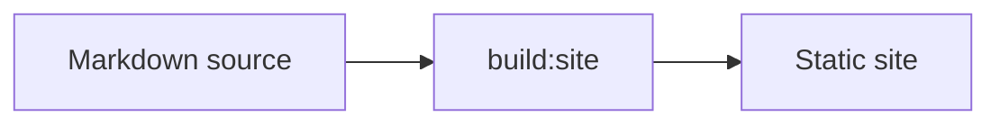

# Writing for the site

This guide tells you how to add content to the Moon-Lander docs site. Write all
content in ASD-STE100 Simplified Technical English. Use short sections, and mix
prose with tables, code and diagrams. Do not write long walls of text.

## Where content goes

| Content | Location | Route on the site |
| --- | --- | --- |
| User docs | a Markdown file below `docs/` | `/docs/<path>/` |
| Package guide | the `README.md` or `README.mbt.md` of a package listed in `packages` of `site/site.json` | `/docs/packages/<name>/` |
| Article | a dated file in `site/articles/` | `/articles/<name>/` |
| Landing page | `site/pages/index.html` | `/` |
| Site settings and sidebar | `site/site.json` | none |
| Static deployment assets | `site/assets/` | `/assets/<path>` |

The build reads only these sources. A file below `docs/` is a page. A link from a
page to a file that is not a page goes to the file on GitHub.

The shared site engine is `moonrockz/telescope@0.4.0`. Moon-Lander supplies its
landing content, scoped landing styles, Mermaid/layers adapters and source rules.
The shared shell supplies the Smithy palette, navigation, search and theme controls.

## Landing page and brand assets

Edit `site/pages/index.html` for landing content and `site/assets/landing.css` for
its layout. Scope styles below the landing root and use Telescope's existing theme
tokens so the documentation and landing page keep the same light/dark colors.
Use logical routes such as `/docs/`; the build adds the active tree base.

For the API index only, use `moon-lander-route://api-index` until Telescope fixes
its 0.4.0 content-link resolver. The native compatibility pass turns that marker
into the active tree's `/api/` link and checks the generated target. Ordinary API
package and item links keep the `api:` syntax described below.

Keep full-size brand originals and generation notes in `docs/assets/brand/`.
Files below `docs/assets/` are assets, not documentation pages. Deployment copies
live in `site/assets/brand/`, outside that excluded directory. Keep icon copies
byte-identical to their originals and use a smaller mascot image for the landing
page. Configure the header and favicon with `header_logo` and `favicon` in
`site/site.json`. Do not copy brand prompts or the local brand preview into the site.

## Front matter

Start each page with front matter between two `---` lines.

```yaml
---
title: Design overview
summary: How Moon-Lander hosting and configuration work.
order: 1
status: proposed
---
```

| Key | Use |
| --- | --- |
| `title` | The page title in the sidebar, the tab and search results |
| `summary` | One sentence for search results and the feed |
| `order` | The position of the page in its sidebar group; a lower number comes first |
| `status` | Only `proposed`. The page shows a banner and the sidebar shows a badge. Use it for a design that is not implemented. |
| `date`, `authors`, `draft` | For articles |

The build fails on an unknown key.

## The sidebar

The `nav` key of `site/site.json` sets the sidebar groups. Each group has a label
and a list of items. An item is a top-level file or directory below `docs/`, for
example `design/` or `WRITING_FOR_THE_SITE.md`, or a glob such as `guides/*`.

```json
"nav": [
  { "group": "Design", "items": ["design/"] },
  { "group": "Contribute", "items": ["WRITING_FOR_THE_SITE.md"] }
]
```

The build fails when an item matches no page, or when a top-level page or directory
is not in `nav`. When you add a new top-level page, add it to `nav` in the same
pull request.

## Links

Write links as relative paths to the source file, so the same link works on GitHub
and on the site.

| You write | The site shows |
| --- | --- |
| `[Design overview](design/overview.md)` | a link to the page route |
| `[Overview](design/overview.md#one-run-start-to-finish)` | a link to the heading anchor; the build checks that it exists |
| `[README](../README.md)` | a link to the file on GitHub, because it is not a page |
| `[Moonbase](https://github.com/moonrockz/Moonbase)` | the same external link |

Example: the [Design overview](design/overview.md) explains the framework.

A link to a path that does not exist, or that leaves the repository, fails the
build. Each internal link on the site starts with the site base path. The build
adds it, so do not write `/moon-lander/` yourself.

## API links

To link to an API reference page, use a Markdown link with the target
`api:<package path>`. Add `#<item>` to go to an item, or `#<Type>.<method>` to go to
a method. The link text is free.

```text
[`CellKind`](api:moonrockz/notebooks#CellKind)
[`CellKind::equal`](api:moonrockz/notebooks#CellKind.equal)
[the notebooks API](api:moonrockz/notebooks)
```

The build changes the target to the route of the API page, for example
`/moon-lander/api/moonrockz/notebooks/#CellKind`. This link goes to
[`CellKind`](api:moonrockz/notebooks#CellKind).

The build fails when the package has no API page, or when the page has no item or
method with that name. The API pages show the packages of the modules in the `api`
key of `site/site.json`.

A method of a trait implementation has the trait name between the type and the
method, for example `#Metadata.Eq.equal`. Below a trait, it has the type, for example
`#Validate.Map[String,T].validate`. To find an anchor, open the API page and copy the
link of the heading.

## Building blocks

Each building block is plain Markdown. The build turns it into HTML. A page needs
no JavaScript to show a block.

### Table

Write a GitHub Markdown table.

```text
| Target | Status |
| --- | --- |
| native | Supported |
| js | Supported |
```

| Target | Status |
| --- | --- |
| native | Supported |
| js | Supported |

### Code

Write a fenced block with a language. The site highlights it for the light and the
dark theme.

````text
```shell
mise run build:site
```
````

```shell
mise run build:site
```

### Diagram

Write a `mermaid` block. The build draws it as an SVG image, so the page loads no
diagram script.

````text

````


### Image or SVG asset

Put the image next to the page and link it with a relative path. The build copies
the file.

```text

```

### Callout

Use the GitHub alert syntax. The kinds are `NOTE`, `TIP`, `IMPORTANT`, `WARNING` and
`CAUTION`. GitHub shows the same callout.

```text
> [!TIP]
> Run `mise run dev:site` to see your change before you push it.
```

> [!TIP]
> Run `mise run dev:site` to see your change before you push it.

### Status

Put `status: proposed` in the front matter of a page about a design that is not
implemented. The page then shows the banner "Proposed — not implemented", and the
sidebar shows a badge.

### Layer stack

Write a `layers` block with one `name | detail` line for each layer. The first line
is the top layer.

````text
```layers
Application | Your commands and services
Hosting | Builder, lifetime and exit codes
Configuration | Sources, merge and binding
```
````

```layers
Application | Your commands and services
Hosting | Builder, lifetime and exit codes
Configuration | Sources, merge and binding
```

## Code examples

The build does not compile code in a page below `docs/`. Put a MoonBit example that
a reader can copy in a `README.mbt.md` file of its package. `moon test` compiles and
runs its `mbt check` blocks, and the package page shows it.

In a page below `docs/`, a `moonbit` or `mbt` block must say `notest`. The build
fails without it.

````text
```moonbit notest
let config = @config.build(sources)
```
````

## Planning documents

Design and implementation plans in `docs/superpowers/` are local agent documents.
They never go on the site, and you must not commit them. Add this line to
`.git/info/exclude` in your clone:

```text
docs/superpowers/
```

Do not change the tracked `.gitignore` for this. The build fails when a file below
`docs/superpowers/` is tracked or not ignored, and `check:site` fails when the
built site has that path.

## Preview and check

Run these tasks from the repository root.

| Task | What it does |
| --- | --- |
| `mise run dev:site` | Builds the site, serves it at `http://127.0.0.1:4173/moon-lander/` and builds again when a source file changes |
| `mise run build:site -- --main` | Builds the site as `main` does, into `_site/` |
| `mise run check:site` | Checks the built site: links, titles, the feed and planning documents |
| `mise run test:site` | Tests the site packages, highlighting and browser behavior against the built site |

Use `mise run test:site -- --port 4178` if another project uses the default browser
test port, 4174.

Before you open a pull request, run `mise run build:site -- --main` and
`mise run check:site`. CI runs them too.
