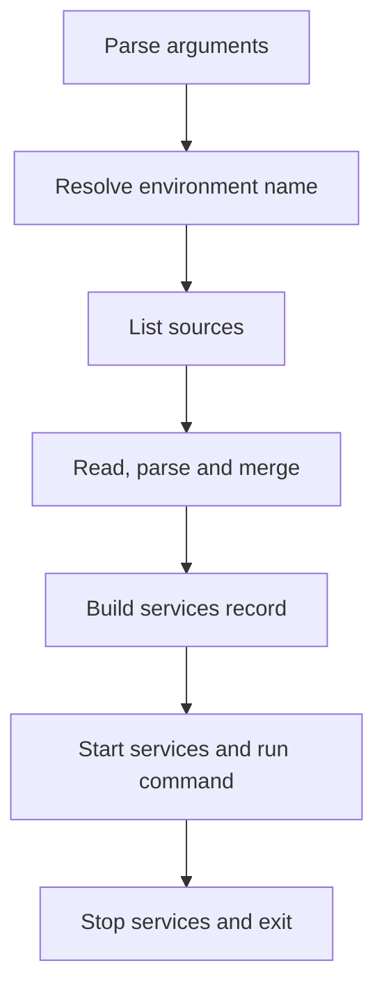

# Design overview

Moon-Lander gives MoonBit an equivalent of .NET hosting and configuration. Four
OpenSpec changes specify it. This page explains them in the order that one CLI run
uses them.

> [!NOTE]
> This page describes a proposed design. The API does not exist yet, so the code
> examples are not compiled. User docs come with each change as it lands.

## One run, start to finish

An application composes a host with pipelines, then calls `run`.

```moonbit notest
// The smallest program: every default is on.
async fn main {
  "acme"
  |> @lander.AppName::parse
  |> @lander.cli(@env.args())
  |> @lander.run(fn(ctx) { ... })
}

// A typed services record and a shorter shutdown timeout.
async fn main {
  "morphir"
  |> @lander.AppName::parse
  |> @lander.cli(@env.args())
  |> @lander.shutdown_timeout(5_000)
  |> @lander.build(fn(b) { App::{ logs: TelemetrySession::local(b.environment.content_root) } })
  |> @lander.run(morphir_command)
}

// Object form: the services record is the program.
impl @lander.Program for App with run(self, ctx) -> Unit raise { build_all(ctx) }

async fn main {
  "morphir"
  |> @lander.AppName::parse
  |> @lander.cli(@env.args())
  |> @lander.run_app(App::new)
}
```

The application name is an `AppName`, not a raw string. `AppName::parse` checks
the name one time, where the program writes it, and a bad name stops the program
at start (design D17). `cli` takes the name first, so the text flows through the
parse into the pipeline. Service names and exit codes are parsed types too.

`run` takes a function. `run_app` takes a factory for a services record that
implements `Program`. MoonBit has no generic traits and no overloading, so the two
forms have two names. Both forms use one engine and the same driver.

The host does these steps in this order:



| Step | What happens | Change |
| --- | --- | --- |
| 1. Parse arguments | argparse reads the arguments one time. The flags `--environment`, `--config`, `--isolated` and `--project` become discovery options. Mapped options become the overrides layer. | host lifecycle |
| 2. Resolve the environment name | The flag, then `MORPHIR_ENVIRONMENT`, then the builder default. With no name, no environment files load. | host lifecycle, conventions |
| 3. List the sources | The conventions provider walks up from the working directory and turns `Discover` into file sources. | conventions |
| 4. Read, parse and merge | Each file parses into one value tree. Sources merge in list order. Each value records its origin. | core |
| 5. Build the services record | The application makes its typed record `S` and binds options from the configuration. | binding, host lifecycle |
| 6. Start services and run the command | Services start in registration order. The command gets `Context[S]` and can check for a stop request. | host lifecycle |
| 7. Stop and exit | Stop hooks run in reverse order inside a timeout. The host gives one exit code. | host lifecycle |

`@lander.cli` takes optional starting values, like .NET
`HostApplicationBuilderSettings`: `env_vars?`, `working_dir?` and `environment?`.
A value that you do not give comes from the process. The run uses one variable set
and one working directory for every step. No other step reads the process, so
tests give the same result each time.

```moonbit notest
// A test: no process reads. Give a Map literal or a Json value, such as a parsed fixture.
"morphir"
|> @lander.AppName::parse
|> @lander.cli(["build"],
  env_vars={ "HOME": "/t/home", "MORPHIR_ENVIRONMENT": "Staging" },
  working_dir="/t/repo/pkgs/api")
```

## Minimal setup and defaults

`@lander` is the batteries-included entry. It turns on a set of defaults, and you
can turn off or change each one. `@hosting.builder` is the bare entry with nothing
on. The Morphir preset uses the bare entry, so it gives the Morphir behavior exactly.

| Default under `@lander` | Value | Change it with the pipeline step |
| --- | --- | --- |
| Formats | TOML, YAML, JSON5 (also reads `.json`) and Ion | `@lander.formats([...])` |
| Conventions | System, XDG, application home, three layouts, local and user overrides, walk-up | `@lander.conventions(...)` |
| Standard flags | `--config`, `--environment`, `--isolated`, `--project` | `@lander.no_standard_flags()` |
| Environment files | Discovery is on. Files load only when a name is set. | `@lander.no_environments()` |
| Variables | `ACME_*` at priority 600. `ACME_HOME` and `ACME_ENVIRONMENT` are reserved. | `@hosting.skip_env_source()` |
| Services | `S = Unit` | `@lander.build(factory)` |
| Driver | Console driver on native and js. Embedded driver on wasm and wasm-gc. | `@hosting.run` for tests |
| Shutdown timeout | 30 seconds, as in .NET | `@lander.shutdown_timeout(ms)` |

The people who use the application need no configuration file. An empty file is
valid. A file sets only the keys that it changes, so this one-line file is complete:

```toml
# acme.toml
ir.strict_mode = true
```

`config show` prints each value with its origin: `defaults`, or the file that set
it. A default that only `bind_or` gives is not in the configuration, so
`config show` does not list it.

The formats come from a MoonBit virtual package, `moonrockz/moon-lander-config/formats`.
Its default implementation returns all the formats. An application can link only
TOML with one override in its own `moon.pkg`. The code does not change.

```moonbit notest
pkgtype(kind: "executable")

options(
  overrides: ["moonrockz/moon-lander-config/formats/toml"],
)
```

The implemented [format selection guide](../../pkgs/config/formats/README.mbt.md)
shows how callers register the selected formats, how to supply a custom set,
and how MoonBit's virtual interface and build-time override make trimming work.

## The layer stack

List order is merge order, and a later layer wins. Each layer has a priority for
reports. The builder rejects a list in which the priorities go down. This stack is
the Morphir order, made from generic parts. The top layer wins.

```layers
Overrides from arguments (700) | --out-dir dist
Environment variables (600) | MORPHIR_IR__STRICT_MODE=true
User override (400) | morphir.user.toml
Local override (390) | morphir.local.toml
Environment file (375) | morphir.Staging.toml
Selected workspace member (350) | pkgs/api/morphir.toml
Workspace or project primary (300) | .config/morphir/config.toml
Global user (200) | $XDG_CONFIG_HOME/morphir/
System (100) | /etc/morphir/
Defaults (0) | compiled in
```

| Layer | Rule |
| --- | --- |
| Environment variables | The prefix is the application name in upper case. `__` separates levels. A single `_` stays in the name. Names become lower case. `true` and `false` become Booleans, and integers become integers. Text that starts with `[` or `{` and parses as JSON becomes JSON. |
| Reserved names | `MORPHIR_HOME` and `MORPHIR_ENVIRONMENT` never become configuration keys. |
| Environment files | They load only when the application turns them on. The Morphir preset keeps them off. |
| Local override | One for each checkout, and git ignores it. Morphir has no local layer, so the Morphir preset keeps it off. |
| User override | The preference of one person, so it wins over the local override. `local` and `user` are reserved environment names. |

## Where files are found

The candidates in one directory, for the application name `morphir`:

| Layout | Example |
| --- | --- |
| Name file | `morphir.toml` |
| Dot directory | `.morphir/morphir.toml` |
| `.config/` convention | `.config/morphir/config.toml` |
| Local override, next to the primary | `morphir.local.toml` |
| User override, next to the primary | `morphir.user.toml` |
| Environment file, next to the primary | `morphir.Staging.toml` |

The extensions come from the formats that the application registers. When two
candidates exist in one directory, loading stops with an error that names both
files.

Discovery follows these rules:

- Discovery walks up from the working directory. The nearest directory with a
  candidate is the project root.
- An optional stop boundary limits the walk. Thus a temporary test root does not
  read configuration from its parent directories.
- `--isolated` skips the system, global, local override and user override layers.
  It keeps the environment variables.
- A file above the root can have a `[workspace]` table. When its `members` globs
  select the root, the root is a member. The workspace file is layer 300, and the
  member file is layer 350.
- Member selection uses the current directory, then `--project` (a path before a
  name), then `default_member`, then a single member.
- Name matching uses directory listings. Thus `App.toml` never matches `app.toml`,
  also on macOS and Windows.

## Formats and merge rules

TOML, YAML, JSON5 and Ion files all parse into one Ion-based value tree before the
merge. `.json` files use the JSON5 parser, so a JSON configuration file can have
comments. The merge follows Morphir:

| Case | Lower layer | Higher layer | Result |
| --- | --- | --- | --- |
| Two tables | `ir = { layout = "a", strict = false }` | `ir = { strict = true }` | `{ layout = "a", strict = true }` |
| Two lists | `targets = ["js", "wasm"]` | `targets = ["native"]` | `["native"]` |
| Null in the higher layer | `{ "out_dir": "dist" }` | `{ "out_dir": null }` | `"dist"` |
| Scalar and table | `log = "info"` | `log = { level = "debug" }` | `{ level = "debug" }` |
| Secret reference | `token = { env = "A" }` | `token = { file = "t.txt" }` | `{ file = "t.txt" }`, kept whole |

A typed merge policy can append lists, as the HOCON `+=` does, or merge list items
by key. A policy applies to one source or to one key path. There is no merge by
list index, as in .NET.

Each value records the source that set it. Each source gives a report with its
status: `loaded`, `not-found` or `skipped`. Pure helpers support the commands
`config get`, `config show`, `config path` and `config explain`. These helpers
redact keys that look like secrets. A secret reference resolves one key at a time,
and only on request.

## Binding to typed values

```moonbit notest
struct IrOptions { layout : String; strict_mode : Bool } derive(FromJson, ToJson)

let ir : IrOptions = config |> @config.bind("ir") // FromJson
let ir2 : IrOptions = config
  |> @config.bind_or("ir", IrOptions::{ layout: "single-file", strict_mode: false })
let mode : String = config |> @config.bind_or("mode", "safe") // a scalar default
let app : AppConfig = config |> @config.bind_root()
```

| Tool | What it does |
| --- | --- |
| `bind_or` | Merges the configuration over the default with the same merge rules. A key that is not set keeps the default. |
| `bind_with`, `FromConfig` | Decode from the Ion tree directly, for decimals, timestamps and large integers that `Json` cannot hold exactly. |
| `Validate` | Runs after decoding and reports all failures together. |
| `Options[T]`, named options | Hold bound values. |
| Unknown-key check | Optional. It finds misspelled keys. It needs a `ToJson` that writes each key that `FromJson` accepts. `RejectExcept` lists the keys of decoders that accept aliases. |

A decode error names the key path and the file that set the bad value, for example
the role `user-override` and `/repo/morphir.user.toml`. It never shows the
configured value. Binding never resolves secrets.

## Host lifecycle

The model follows .NET `IHostApplicationLifetime` and `IHostedService`. It adds one
guarantee: when a start fails, the services that started before it still stop. The
application defines a typed services record `S`. There is no DI container.


Start hooks run in registration order. Stop hooks run in reverse order, inside the
shutdown timeout. A stop hook that fails does not prevent the other hooks.

Any code can call `stop_application()`. A running command sees the request through
`ctx.cancelled()` or `ctx.check_cancelled()`. Each target receives stop requests in
its own way:

| Target | Stop requests |
| --- | --- |
| native | A Zig stub in prebuilt objects, with a C fallback. It handles SIGINT, SIGTERM and SIGQUIT, or the Windows console events. |
| js | The TypeScript adapter uses `process.on`. |
| wasm, wasm-gc | Only `stop_application()` or a call from the embedder. |

A second signal ends the process at once, also during synchronous work. The host
gives one exit code:

| Code | When |
| --- | --- |
| 0 | A clean run |
| 1 | An unhandled failure, a stop hook that fails, or a timeout |
| 2 | A configuration error or a usage error |
| 130 | SIGINT or `CTRL_C_EVENT` |
| 131 | SIGQUIT or `CTRL_BREAK_EVENT` |
| 143 | SIGTERM or `CTRL_CLOSE_EVENT` |

A signal code wins over the other codes. An application can set its own code with
`stop_application(exit_code=4)`.

## FileTree: how loading stays pure

Discovery and file sources never read a disk. They read a `FileTree`, an immutable
snapshot of directory listings and file text. The pure function
`@config.load(builder, tree)` returns `Need(requests)` when the tree does not have
a path. It returns `Done(config)` when the tree has all the paths. The same tree
gives the same result on all four targets.

| Path state | Meaning |
| --- | --- |
| Held | The tree has the listing or the file text. The loader uses it. |
| Missing | The tree records the absence with `with_missing`, or the path is below a missing directory, or the tree is complete and does not hold the path. |
| Unknown | The path is not held and not missing in an incomplete tree. Only these paths go into a `Need`. |

| Target | What answers a `Need` |
| --- | --- |
| native | `moonrockz/moon-lander-config/host` with the `moonbitlang/async` file system |
| js | `moonrockz/moon-lander-config/host` with a TypeScript adapter over `node:fs`, bundled with Bun |
| wasm, wasm-gc | Nothing. The embedder gives a complete tree with the pipeline step `@hosting.files(tree)`. |

## The four changes

| Change | What it owns |
| --- | --- |
| [add-configuration-core](https://github.com/moonrockz/moon-lander/tree/main/openspec/changes/archive/2026-10-21-add-configuration-core) | Value tree, sources, formats, merge, provenance, secrets, errors, FileTree, host file adapters |
| [add-configuration-conventions](https://github.com/moonrockz/moon-lander/tree/main/openspec/changes/archive/2026-10-22-add-configuration-conventions) | Discovery, layouts, workspaces, environments, local and user overrides, Morphir preset |
| [add-configuration-binding](https://github.com/moonrockz/moon-lander/tree/main/openspec/changes/archive/2026-10-22-add-configuration-binding) | Typed binding, validation, options |
| [add-host-lifecycle](https://github.com/moonrockz/moon-lander/tree/main/openspec/changes/add-host-lifecycle) | Builder, starting values, defaults, arguments, services, lifetime, signals, exit codes |

These items are not in scope now: a DI container, reload when a file changes, a new
CLI parser (argparse stays), a logging abstraction, and a general virtual file
system.

> [!TIP]
> Each `design.md` labels its decisions. "Owner" marks a decision of a maintainer.
> "Call" marks a decision of the author. Reviewers check the "Call" decisions first.
