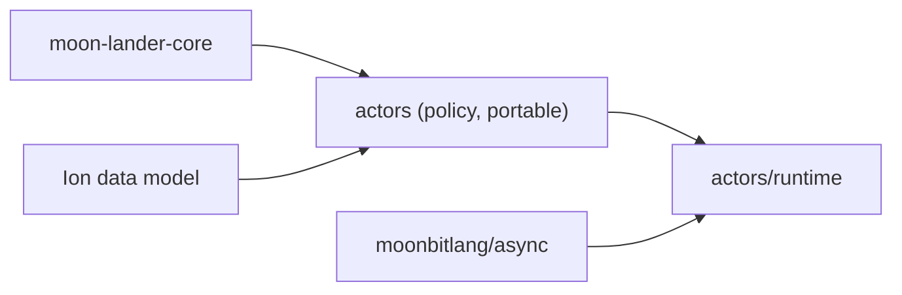

# Actors

`moonrockz/moon-lander-actors` gives local typed actors: units that own private
state and one mailbox and handle one message at a time. A scope owns each
actor's lifetime. No actor system, registry or host is necessary.

The module has two packages:

| Package | Alias | Targets | Contents |
| --- | --- | --- | --- |
| `moonrockz/moon-lander-actors` | `@policy` | `wasm`, `wasm-gc`, `js`, `native` | Checked policy values: `MailboxCapacity`, `MessageCount`, `MailboxPolicy`, `Admission`, `PayloadPolicy` |
| `moonrockz/moon-lander-actors/runtime` | `@actors` | `wasm`, `js`, `native` | Scopes, actors, references, replies and `Receive` values. See [the runtime guide](runtime/README.mbt.md) |

The module imports `moonrockz/moon-lander-core`, `moonbitlang/async` and
`moonrockz/ion@0.6.0`. Its packages use only the Ion data model,
`moonrockz/ion/ion`, with no text, binary, schema or JSON codec package.
It does not depend on hosting, configuration, mediator or logging, and the
umbrella module does not import it.



Each `mbt check` block on this page runs as a test with `mise run test` on all
four targets.

## Checked policy values

A mailbox capacity and a message count are positive numbers from one to the
largest `Int`. Their constructors are the only way to make them, and they raise
a typed `CountError` that holds the input and the broken rule.

```mbt check
///|
test "a capacity is positive" {
  assert_eq(@policy.MailboxCapacity::from_int(1).to_int(), 1)
  let rejected = try {
    ignore(@policy.MailboxCapacity::from_int(0))
    None
  } catch {
    InvalidCapacity(input~, rule=NotPositive) => Some(input)
    InvalidCount(..) => None
  }
  assert_eq(rejected, Some(0))
}
```

The default mailbox policy is bounded at 128 queued messages. An unbounded
mailbox is an explicit choice:

```mbt check
///|
test "the default policy is bounded at 128" {
  guard @policy.MailboxPolicy::default() is Bounded(capacity) else {
    fail("the default is unbounded")
  }
  assert_eq(capacity.to_int(), 128)
  assert_true(@policy.MailboxPolicy::Unbounded != @policy.MailboxPolicy::default())
}
```

## Message payloads

`PayloadPolicy[M]` selects the data for an undelivered-event payload. The policy
is portable on all four targets. `omit()` is the default and accepts any protocol,
including messages with replies or closures. `apply(message)` returns `None`
for omission, or the encoded Ion value. The runtime applies a policy only for an
undelivered event with an active subscriber.

Messages can hold passwords, tokens and other secrets. `ion()` and `json()`
encode the whole message. Enable them only when all message fields can be
written to an event or log. Use `encode()` to remove secret fields. Its encoder
cannot raise.

```mbt check
///|
enum Change {
  Add(Int)
} derive(ToJson)

///|
test "omit is the default and JSON bridges a derived protocol" {
  let omitted : @policy.PayloadPolicy[Change] = @policy.PayloadPolicy::default()
  assert_true(omitted.apply(Add(3)) is None)
  assert_true(@policy.PayloadPolicy::omit().apply(Add(3)) is None)
  let json : @policy.PayloadPolicy[Change] = @policy.PayloadPolicy::json()
  guard json.apply(Add(3)) is Some(payload) else { fail("missing payload") }
  assert_true(payload.equals(@ion.Ion(ToJson::to_json(Add(3)))))
}
```

Implement `@ion.ToIon` for a protocol to preserve Ion types such as decimals and
timestamps. `ToIon` cannot be derived. The JSON bridge above needs only
`derive(ToJson)` and uses `@ion.Ion(message.to_json())`.

```mbt check
///|
enum Measurement {
  Record(@ion.Decimal, @ion.Timestamp)
}

///|
impl @ion.ToIon for Measurement with to_ion(self) {
  let Record(amount, time) = self
  @ion.Ion::list([@ion.Ion::decimal(amount), @ion.Ion::timestamp(time)])
}

///|
test "Ion keeps decimal and timestamp types" {
  let amount = @ion.Decimal::parse("12.340")
  let time = @ion.Timestamp::parse("2026-10-31T12:34:56Z")
  let policy : @policy.PayloadPolicy[Measurement] = @policy.PayloadPolicy::ion()
  guard policy.apply(Record(amount, time)) is Some(payload) else { fail("missing payload") }
  assert_true(payload.equals(@ion.Ion::list([
    @ion.Ion::decimal(amount), @ion.Ion::timestamp(time),
  ])))
}
```

A custom encoder can select data fields and replace a secret:

```mbt check
///|
enum Login {
  Authenticate(String, String)
}

///|
test "redact a secret before it enters an event" {
  let policy : @policy.PayloadPolicy[Login] = @policy.PayloadPolicy::encode(message => {
    let Authenticate(user, _secret) = message
    @ion.Ion::from_fields([
      @ion.Field("user", @ion.Ion::string(user)),
      @ion.Field("secret", @ion.Ion::string("[redacted]")),
    ])
  })
  guard policy.apply(Authenticate("reader", "private-token")) is Some(payload) else {
    fail("missing payload")
  }
  assert_true(payload.equals(@ion.Ion::from_fields([
    @ion.Field("user", @ion.Ion::string("reader")),
    @ion.Field("secret", @ion.Ion::string("[redacted]")),
  ])))
}
```

`let policy : @policy.PayloadPolicy[Change] = @policy.PayloadPolicy::ion()`
does not compile because `Change` has no `@ion.ToIon` implementation. Select
`json()` for that protocol. A protocol with neither codec can use `omit()` or
`encode()`. The task-script tests in `scripts/check-actors.mbtx` check wrong
codec selection, a raising encoder and private-field construction on all four
targets, with a valid consumer as the control.
