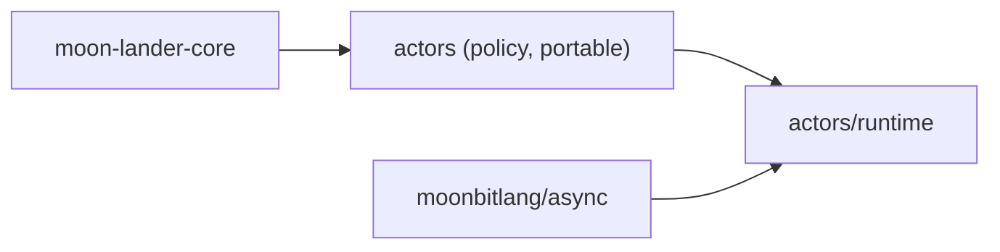

# Actors

`moonrockz/moon-lander-actors` gives local typed actors: units that own private
state and one mailbox and handle one message at a time. A scope owns each
actor's lifetime. No actor system, registry or host is necessary.

The module has two packages:

| Package | Alias | Targets | Contents |
| --- | --- | --- | --- |
| `moonrockz/moon-lander-actors` | `@policy` | `wasm`, `wasm-gc`, `js`, `native` | Checked policy values: `MailboxCapacity`, `MessageCount`, `MailboxPolicy`, `Admission` |
| `moonrockz/moon-lander-actors/runtime` | `@actors` | `wasm`, `js`, `native` | Scopes, actors, references, replies and `Receive` values. See [the runtime guide](runtime/README.mbt.md) |

The module imports only `moonrockz/moon-lander-core` and `moonbitlang/async`.
It does not depend on hosting, configuration, mediator or logging, and the
umbrella module does not import it.



Each `mbt check` block on this page runs as a test with `mise run test` on all
four targets.

## Checked policy values

A mailbox capacity and a message count are positive numbers from one to the
largest `Int`. Their constructors are the only way to make them, and they raise
a typed `CountError` that holds the input and the broken rule.

```mbt check
///|
test "a capacity is positive" {
  assert_eq(@policy.MailboxCapacity::from_int(1).to_int(), 1)
  let rejected = try {
    ignore(@policy.MailboxCapacity::from_int(0))
    None
  } catch {
    InvalidCapacity(input~, rule=NotPositive) => Some(input)
    InvalidCount(..) => None
  }
  assert_eq(rejected, Some(0))
}
```

The default mailbox policy is bounded at 128 queued messages. An unbounded
mailbox is an explicit choice:

```mbt check
///|
test "the default policy is bounded at 128" {
  guard @policy.MailboxPolicy::default() is Bounded(capacity) else {
    fail("the default is unbounded")
  }
  assert_eq(capacity.to_int(), 128)
  assert_true(@policy.MailboxPolicy::Unbounded != @policy.MailboxPolicy::default())
}
```
