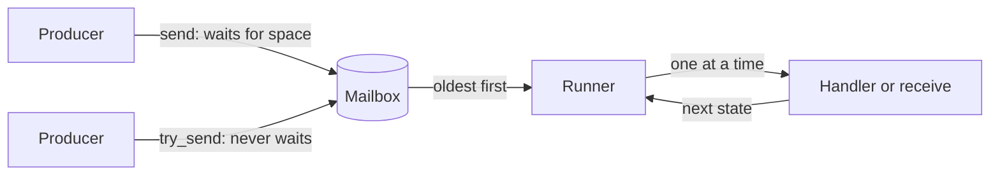

# Actor runtime

The `runtime` package (`@actors`) runs local typed actors. An actor owns
private state and one mailbox, and handles one message at a time. It is like a
lightweight BEAM process, but it is cooperative and shares memory with the
other actors of the program. It is not an operating-system process.

Import the package as `@actors`. The portable policy values of the root package
(`MailboxPolicy`, `MailboxCapacity`, `MessageCount`, `Admission`) are also
available through this import.

```text
import {
  "moonrockz/moon-lander-actors/runtime" @actors,
}
```

| Target | Supported | Note |
| --- | --- | --- |
| `native`, `js` | Yes | The actors use the application's `moonbitlang/async` event loop |
| `wasm` | Yes | The embedder must supply the `moonbitlang/async` event-loop imports |
| `wasm-gc` | No | `moonbitlang/async` has no event loop there. A build that imports this package for `wasm-gc` fails |

Each `mbt check` block on this page runs as a test with `mise run test` on
`wasm`, `js` and `native`.

## A counter

An actor needs a protocol, a handler and a scope. The protocol is an ordinary
enum. A case that wants an answer carries a typed `Reply`. The handler gets the
state and one message, and gives `Continue(next_state)` or `Stop`.

```mbt check
///|
enum Tally {
  Bump
  Total(@actors.Reply[Int])
}

///|
async test "a counter replies one after one increment" {
  let count = @actors.scope <| scope => {
    let counter = scope.start(0) <| (state, message) => {
      match message {
        Bump => @actors.Continue(state + 1)
        Total(reply) => {
          ignore(reply.send(state))
          @actors.Continue(state)
        }
      }
    }
    counter.send(Bump)
    counter.ask(reply => Total(reply))
  }
  assert_eq(count, 1)
}
```

The example uses the pipeline form. Each function takes its subject first and
its callback last, so `<|` passes the callback, and options are labelled. A
lambda after `<|` needs a braced body. The same call without pipelines is
`@actors.scope(scope => { ... })` and `scope.start(0, (state, message) => { ... })`.

There is no actor system, registry, trait or builder. The scope owns the actor:
when the body of `scope` returns, the scope cancels its live actors and waits
for them to end. An actor that fails fails its scope.

| Value | Meaning |
| --- | --- |
| `Scope` | The owner of actor lifetimes; `@actors.scope(body)` makes it |
| `Actor[M, R]` | The owner handle of an actor with protocol `M` and result `R` |
| `ActorRef[M]` | A send-only reference: `actor.to_ref()`. It cannot receive, stop or join |
| `Reply[R]` | A one-shot destination for the answer to one request |
| `ActorAddress` | The identity of one actor lifetime: `actor.address()` |

A reference accepts only its protocol. `counter.send("text")` does not compile.

## How a message moves



A send puts the message in the mailbox. It never calls the handler on the
sender's task. The actor's one runner takes the messages and calls the handler
for one message at a time, also when the handler waits. Different actors make
progress while one actor waits.

## Admission and processing

`send` returns when the mailbox **admits** the message, not when the actor
**processes** it. Admission is the one commit point:

| Event | Result |
| --- | --- |
| The sender is cancelled while `send` waits for space | No message enters the mailbox |
| The sender is cancelled after admission | The message stays, and the actor processes it one time |
| The actor ends while `send` waits for space | `send` raises `Closed`, and the message does not enter |

The default mailbox holds 128 queued messages. The message in progress does not
count. When the mailbox is full, `send` waits. `try_send` never waits and gives
an `Admission`:

| `Admission` | Meaning |
| --- | --- |
| `Accepted` | The mailbox admitted the message |
| `Full` | The bounded mailbox is full. The message was not admitted |
| `Closed` | The mailbox admits no more messages |

No policy drops or overwrites a message. Select another capacity with
`mailbox=Bounded(capacity)`, or opt into no limit with `mailbox=Unbounded`.

```mbt check
///|
async test "a full mailbox gives Full, and an unbounded mailbox never does" {
  @actors.scope <| scope => {
    let gate : @aio.Queue[Unit] = @aio.Queue(kind=Unbounded)
    let one = @actors.MailboxCapacity::from_int(1)
    let slow = scope.start((), mailbox=Bounded(one)) <| (_, _ : Int) => {
      gate.get()
      @actors.Continue(())
    }
    slow.send(1) // in progress: it does not count
    while slow.queued_count() > 0 {
      @aio.pause()
    }
    assert_eq(slow.try_send(2), Accepted)
    assert_eq(slow.try_send(3), Full)
    gate.put(())
    gate.put(())
    let open = scope.start((), mailbox=Unbounded) <| (_, _ : Int) => {
      @actors.Continue(())
    }
    for message in 0..<500 {
      assert_eq(open.try_send(message), Accepted)
    }
  }
}
```

`queued_count()` is a snapshot of the queued messages. It is not a readiness
test: the count can change before the next line runs. A busy actor lets other
tasks run after each batch of messages. A handler that never suspends still
blocks the whole runtime while it runs.

### Mutable messages

Actors share memory. A message that holds a mutable value, such as an `Array`
or a `Ref`, gives the actor a reference to the same value that the sender
holds. Send immutable values, copy at the sender, or stop using the value after
the send.

### A send to itself

An actor that waits in `send` on its own full mailbox waits forever, because
only the actor itself can make space. Use `ActorContext::reenqueue`. It appends
at the tail without waiting and gives the same `Admission` as `try_send`.

## Receive values

`start` covers most actors. For an actor that takes different messages in
different phases, `spawn` takes a function that gets the actor's
`ActorContext` and gives a `Receive[M, R]`: an immutable description of what
the actor receives next and of its result `R`. Only the runtime and the test
runner run a receive, so no other code can take a message from a mailbox.

| Function | Result |
| --- | --- |
| `receive()` | The oldest message |
| `select(choose)` | The value of the oldest message for which `choose` gives `Some` |
| `done(value)` | `value`, with no message |
| `poll(on_empty~)` | The oldest message, or `on_empty()` at once when none is queued |
| `receive_loop(initial, handler)` | `handler` for each message until `Stop` or close; the last state. `start` runs this loop |
| `receive_all(handler)` | `handler` for each message until close |
| `receive_n(count, handler)` | `handler` for at most `count` messages |

| Combinator | Meaning |
| --- | --- |
| `r.map(f)` | Change the result |
| `r.zip(other)`, `r.zip_with(other, f)` | Run `r`, then `other`; keep both results, or join them |
| `r.then(other)` | Run `r`, drop its result, then run `other` |
| `r.bind(next)` | Run `r`, then the receive that the async function `next` makes from its result |
| `r.within(limit, on_timeout~)` | When `r` has waited for messages longer than the `TimeLimit` in total, continue with `on_timeout()`. Work between two waits does not count |
| `r.on_closed(f)` | When the mailbox closes while `r` waits, continue with `f()` |
| `r.recover(on_error)` | When a step of `r` raises an ordinary error, continue with `on_error(error)` |

Combinators are methods, so they chain with `.`. Independent steps stay flat.
A step that needs an earlier value uses `bind`. Async work between two receives
also goes in `bind`.

```mbt check
///|
enum SignIn {
  Hello(String)
  Pin(Int)
  Chatter(String)
} derive(Eq, Debug)

///|
fn hello_name(message : SignIn) -> String? {
  match message {
    Hello(name) => Some(name)
    _ => None
  }
}

///|
fn pin_value(message : SignIn) -> Int? {
  match message {
    Pin(pin) => Some(pin)
    _ => None
  }
}

///|
/// The first Hello and the first Pin, in any order, within five seconds.
fn sign_in() -> @actors.Receive[SignIn, String] {
  let five_seconds = @lander_core.TimeLimit::seconds(5) catch { _ => panic() }
  @actors.select(hello_name)
  .zip_with(@actors.select(pin_value), (name, pin) => "\{name}:\{pin}")
  .within(five_seconds, on_timeout=() => @actors.done("timed out"))
}

///|
async test "an actor joins two selected messages" {
  let result = @actors.scope <| scope => {
    let actor = scope.spawn(_ => sign_in())
    actor.send(Chatter("noise"))
    actor.send(Pin(7))
    actor.send(Hello("ann"))
    actor.join()
  }
  assert_eq(result, "ann:7")
}
```

A state loop is `receive_loop`. The handler gives `Continue` or `Stop`, and the
result is the last state:

```mbt check
///|
async test "a state loop adds values until a stop message" {
  let sum = @actors.receive_loop(0) <| (total, message : Int?) => {
    match message {
      Some(value) => @actors.Continue(total + value)
      None => @actors.Stop
    }
  }
  let total = @actors.scope <| scope => {
    let actor = scope.spawn(_ => sum)
    actor.send(Some(40))
    actor.send(Some(2))
    actor.send(None)
    actor.join()
  }
  assert_eq(total, 42)
}
```

`recover` catches an ordinary error of a step, also an error of a selector or
of a loop handler, and the actor continues. It does not catch cancellation.
Without `recover`, the error fails the actor and its owner scope.

### The actor context

`ActorContext[M]` gives the actor's own reference (`self_ref`), the scope of its
children (`scope`), `reenqueue` and `queued_count`. It has no receive
operation, so it is safe to give to another task. A child that starts in the
context's scope ends before its parent ends, also when the parent completes
normally.

## Test a receive without a scope

A receive is a value, so a unit test can run it against a list of messages,
with no scope, task group or clock. This is the preferred unit-test style for
actor logic. `run_messages` gives the result, or `None` when the receive waits
for another message. `run_test` also gives the messages that remain.

```mbt check
///|
async test "sign_in takes the first pin after hello and leaves the chatter" {
  let messages = [Chatter("x"), Pin(7), Hello("ann"), Chatter("y")]
  assert_eq(sign_in() |> @actors.run_messages(messages), Some("ann:7"))
  let run = @actors.run_test(sign_in(), messages)
  assert_eq(run.remaining(), [Chatter("x"), Chatter("y")])
}

///|
async test "sign_in times out when no pin arrives" {
  let run = @actors.run_test(sign_in(), [Hello("ann")], at_end=Expire)
  assert_eq(run.result(), Some("timed out"))
}
```

`at_end` says what a receive does when it must wait after the last message:

| `TestEnd` | Behavior |
| --- | --- |
| `Wait` (default) | The run stops. The outcome is `Waiting` |
| `Expire` | The time limit that ends first expires at once |
| `Close` | The mailbox is closed after the messages |

A test that needs the real runtime orders its events with acknowledgements,
such as an `@aio.Queue`, not with sleeps.

Running a receive does not make the call stack grow with its steps. The test
suite runs loops of 100,000 steps, both a loop that carries its state forward
and a loop that builds its result after the recursive step, on each target.

## Selective receive and a full mailbox

`select` checks the queued messages oldest first. It removes only the first
match, and the other messages keep their order. While it waits, it checks each
new arrival. The skipped messages stay in the one mailbox and count against its
capacity.

So a bounded mailbox that is full of messages that a `select` skips admits no
new message, also the message that the `select` waits for. The `select` waits,
and the senders wait. Choose one of these recoveries:

| Recovery | Effect |
| --- | --- |
| `within(limit, on_timeout~)` | The `select` stops waiting; the queued messages stay in order |
| Take a skipped message | `receive()` or another `select` makes space for one more message |
| `mailbox=Unbounded` | The mailbox never fills; memory use can grow |

```mbt check
///|
async test "a timed select on a full mailbox of skipped messages keeps them" {
  let log = @actors.scope <| scope => {
    let one = @actors.MailboxCapacity::from_int(1)
    let ten_ms = @lander_core.TimeLimit::millis(10) catch { _ => panic() }
    let actor = scope.spawn(mailbox=Bounded(one)) <| _ => {
      @actors.select(hello_name)
      .within(ten_ms, on_timeout=() => @actors.done("timed out"))
      .zip(@actors.receive())
    }
    actor.send(Chatter("skipped"))
    // The skipped message fills the mailbox: the Hello cannot enter.
    assert_eq(actor.try_send(Hello("ann")), Full)
    actor.join()
  }
  assert_eq(log, ("timed out", Chatter("skipped")))
}
```

No message has a priority that bypasses the capacity.
