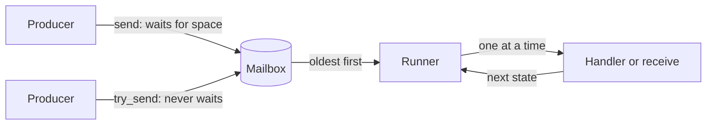

# Actor runtime

The `runtime` package (`@actors`) runs local typed actors. An actor owns
private state and one mailbox, and handles one message at a time. It is like a
lightweight BEAM process, but it is cooperative and shares memory with the
other actors of the program. It is not an operating-system process.

Import the package as `@actors`. The portable policy values of the root package
(`MailboxPolicy`, `MailboxCapacity`, `MessageCount`, `Admission`) are also
available through this import.

```text
import {
  "moonrockz/moon-lander-actors/runtime" @actors,
}
```

| Target | Supported | Note |
| --- | --- | --- |
| `native`, `js` | Yes | The actors use the application's `moonbitlang/async` event loop |
| `wasm` | Yes | The embedder must supply the `moonbitlang/async` event-loop imports |
| `wasm-gc` | No | `moonbitlang/async` has no event loop there. A build that imports this package for `wasm-gc` fails |

Each `mbt check` block on this page runs as a test with `mise run test` on
`wasm`, `js` and `native`.

## A counter

An actor needs a protocol, a handler and a scope. The protocol is an ordinary
enum. A case that wants an answer carries a typed `Reply`. The handler gets the
state and one message, and gives `Continue(next_state)` or `Stop`.

```mbt check
///|
enum Tally {
  Bump
  Total(@actors.Reply[Int])
}

///|
async test "a counter replies one after one increment" {
  let count = @actors.scope <| scope => {
    let counter = scope.start(0) <| (state, message) => {
      match message {
        Bump => @actors.Continue(state + 1)
        Total(reply) => {
          ignore(reply.send(state))
          @actors.Continue(state)
        }
      }
    }
    counter.send(Bump)
    counter.ask(reply => Total(reply))
  }
  assert_eq(count, 1)
}
```

The example uses the pipeline form. Each function takes its subject first and
its callback last, so `<|` passes the callback, and options are labelled. A
lambda after `<|` needs a braced body. The same call without pipelines is
`@actors.scope(scope => { ... })` and `scope.start(0, (state, message) => { ... })`.

There is no actor system, registry, trait or builder. The scope owns the actor:
when the body of `scope` returns, the scope cancels its live actors and waits
for them to end. An actor that fails fails its scope.

| Value | Meaning |
| --- | --- |
| `Scope` | The owner of actor lifetimes; `@actors.scope(body)` makes it |
| `Actor[M, R]` | The owner handle of an actor with protocol `M` and result `R` |
| `ActorRef[M]` | A send-only reference: `actor.to_ref()`. It cannot receive, stop or join |
| `Reply[R]` | A one-shot destination for the answer to one request |
| `ActorAddress` | The identity of one actor lifetime: `actor.address()` |

A reference accepts only its protocol. `counter.send("text")` does not compile.

## How a message moves



A send puts the message in the mailbox. It never calls the handler on the
sender's task. The actor's one runner takes the messages and calls the handler
for one message at a time, also when the handler waits. Different actors make
progress while one actor waits.

## Admission and processing

`send` returns when the mailbox **admits** the message, not when the actor
**processes** it. Admission is the one commit point:

| Event | Result |
| --- | --- |
| The sender is cancelled while `send` waits for space | No message enters the mailbox |
| The sender is cancelled after admission | The message stays, and the actor processes it one time |
| The actor ends while `send` waits for space | `send` raises `Closed`, and the message does not enter |

The default mailbox holds 128 queued messages. The message in progress does not
count. When the mailbox is full, `send` waits. `try_send` never waits and gives
an `Admission`:

| `Admission` | Meaning |
| --- | --- |
| `Accepted` | The mailbox admitted the message |
| `Full` | The bounded mailbox is full. The message was not admitted |
| `Closed` | The mailbox admits no more messages |

No policy drops or overwrites a message. Select another capacity with
`mailbox=Bounded(capacity)`, or opt into no limit with `mailbox=Unbounded`.

```mbt check
///|
async test "a full mailbox gives Full, and an unbounded mailbox never does" {
  @actors.scope <| scope => {
    let gate : @aio.Queue[Unit] = @aio.Queue(kind=Unbounded)
    let one = @actors.MailboxCapacity::from_int(1)
    let slow = scope.start((), mailbox=Bounded(one)) <| (_, _ : Int) => {
      gate.get()
      @actors.Continue(())
    }
    slow.send(1) // in progress: it does not count
    while slow.queued_count() > 0 {
      @aio.pause()
    }
    assert_eq(slow.try_send(2), Accepted)
    assert_eq(slow.try_send(3), Full)
    gate.put(())
    gate.put(())
    let open = scope.start((), mailbox=Unbounded) <| (_, _ : Int) => {
      @actors.Continue(())
    }
    for message in 0..<500 {
      assert_eq(open.try_send(message), Accepted)
    }
  }
}
```

`queued_count()` is a snapshot of the queued messages. It is not a readiness
test: the count can change before the next line runs. A busy actor lets other
tasks run after each batch of messages. A handler that never suspends still
blocks the whole runtime while it runs.

### Mutable messages

Actors share memory. A message that holds a mutable value, such as an `Array`
or a `Ref`, gives the actor a reference to the same value that the sender
holds. Send immutable values, copy at the sender, or stop using the value after
the send.

### A send to itself

An actor that waits in `send` on its own full mailbox waits forever, because
only the actor itself can make space. Use `ActorContext::reenqueue`. It appends
at the tail without waiting and gives the same `Admission` as `try_send`.

## Receive values

`start` covers most actors. For an actor that takes different messages in
different phases, `spawn` takes a function that gets the actor's
`ActorContext` and gives a `Receive[M, R]`: an immutable description of what
the actor receives next and of its result `R`. Only the runtime and the test
runner run a receive, so no other code can take a message from a mailbox.

| Function | Result |
| --- | --- |
| `receive()` | The oldest message |
| `select(choose)` | The value of the oldest message for which `choose` gives `Some` |
| `done(value)` | `value`, with no message |
| `poll(on_empty~)` | The oldest message, or `on_empty()` at once when none is queued |
| `receive_loop(initial, handler)` | `handler` for each message until `Stop` or close; the last state. `start` runs this loop |
| `receive_all(handler)` | `handler` for each message until close |
| `receive_n(count, handler)` | `handler` for at most `count` messages |

| Combinator | Meaning |
| --- | --- |
| `r.map(f)` | Change the result |
| `r.zip(other)`, `r.zip_with(other, f)` | Run `r`, then `other`; keep both results, or join them |
| `r.then(other)` | Run `r`, drop its result, then run `other` |
| `r.bind(next)` | Run `r`, then the receive that the async function `next` makes from its result |
| `r.within(limit, on_timeout~)` | When `r` has waited for messages longer than the `TimeLimit` in total, continue with `on_timeout()`. Work between two waits does not count |
| `r.on_closed(f)` | When the mailbox closes while `r` waits, continue with `f()` |
| `r.recover(on_error)` | When a step of `r` raises an ordinary error, continue with `on_error(error)` |

Combinators are methods, so they chain with `.`. Independent steps stay flat.
A step that needs an earlier value uses `bind`. Async work between two receives
also goes in `bind`.

```mbt check
///|
enum SignIn {
  Hello(String)
  Pin(Int)
  Chatter(String)
} derive(Eq, Debug)

///|
fn hello_name(message : SignIn) -> String? {
  match message {
    Hello(name) => Some(name)
    _ => None
  }
}

///|
fn pin_value(message : SignIn) -> Int? {
  match message {
    Pin(pin) => Some(pin)
    _ => None
  }
}

///|
/// The first Hello and the first Pin, in any order, within five seconds.
fn sign_in() -> @actors.Receive[SignIn, String] {
  let five_seconds = @lander_core.TimeLimit::seconds(5) catch { _ => panic() }
  @actors.select(hello_name)
  .zip_with(@actors.select(pin_value), (name, pin) => "\{name}:\{pin}")
  .within(five_seconds, on_timeout=() => @actors.done("timed out"))
}

///|
async test "an actor joins two selected messages" {
  let result = @actors.scope <| scope => {
    let actor = scope.spawn(_ => sign_in())
    actor.send(Chatter("noise"))
    actor.send(Pin(7))
    actor.send(Hello("ann"))
    actor.join()
  }
  assert_eq(result, "ann:7")
}
```

A state loop is `receive_loop`. The handler gives `Continue` or `Stop`, and the
result is the last state:

```mbt check
///|
async test "a state loop adds values until a stop message" {
  let sum = @actors.receive_loop(0) <| (total, message : Int?) => {
    match message {
      Some(value) => @actors.Continue(total + value)
      None => @actors.Stop
    }
  }
  let total = @actors.scope <| scope => {
    let actor = scope.spawn(_ => sum)
    actor.send(Some(40))
    actor.send(Some(2))
    actor.send(None)
    actor.join()
  }
  assert_eq(total, 42)
}
```

`recover` catches an ordinary error of a step, also an error of a selector or
of a loop handler, and the actor continues. It does not catch cancellation.
Without `recover`, the error fails the actor and its owner scope.

### The actor context

`ActorContext[M]` gives the actor's own reference (`self_ref`), the scope of its
children (`scope`), `reenqueue` and `queued_count`. It has no receive
operation, so it is safe to give to another task. A child that starts in the
context's scope ends before its parent ends, also when the parent completes
normally.

## Test a receive without a scope

A receive is a value, so a unit test can run it against a list of messages,
with no scope, task group or clock. This is the preferred unit-test style for
actor logic. `run_messages` gives the result, or `None` when the receive waits
for another message. `run_test` also gives the messages that remain.

```mbt check
///|
async test "sign_in takes the first pin after hello and leaves the chatter" {
  let messages = [Chatter("x"), Pin(7), Hello("ann"), Chatter("y")]
  assert_eq(sign_in() |> @actors.run_messages(messages), Some("ann:7"))
  let run = @actors.run_test(sign_in(), messages)
  assert_eq(run.remaining(), [Chatter("x"), Chatter("y")])
}

///|
async test "sign_in times out when no pin arrives" {
  let run = @actors.run_test(sign_in(), [Hello("ann")], at_end=Expire)
  assert_eq(run.result(), Some("timed out"))
}
```

`at_end` says what a receive does when it must wait after the last message:

| `TestEnd` | Behavior |
| --- | --- |
| `Wait` (default) | The run stops. The outcome is `Waiting` |
| `Expire` | The time limit that ends first expires at once |
| `Close` | The mailbox is closed after the messages |

A test that needs the real runtime orders its events with acknowledgements,
such as an `@aio.Queue`, not with sleeps.

Running a receive does not make the call stack grow with its steps. The test
suite runs loops of 100,000 steps, both a loop that carries its state forward
and a loop that builds its result after the recursive step, on each target.

## Selective receive and a full mailbox

`select` checks the queued messages oldest first. It removes only the first
match, and the other messages keep their order. While it waits, it checks each
new arrival. The skipped messages stay in the one mailbox and count against its
capacity.

So a bounded mailbox that is full of messages that a `select` skips admits no
new message, also the message that the `select` waits for. The `select` waits,
and the senders wait. Choose one of these recoveries:

| Recovery | Effect |
| --- | --- |
| `within(limit, on_timeout~)` | The `select` stops waiting; the queued messages stay in order |
| Take a skipped message | `receive()` or another `select` makes space for one more message |
| `mailbox=Unbounded` | The mailbox never fills; memory use can grow |

```mbt check
///|
async test "a timed select on a full mailbox of skipped messages keeps them" {
  let log = @actors.scope <| scope => {
    let one = @actors.MailboxCapacity::from_int(1)
    let ten_ms = @lander_core.TimeLimit::millis(10) catch { _ => panic() }
    let actor = scope.spawn(mailbox=Bounded(one)) <| _ => {
      @actors.select(hello_name)
      .within(ten_ms, on_timeout=() => @actors.done("timed out"))
      .zip(@actors.receive())
    }
    actor.send(Chatter("skipped"))
    // The skipped message fills the mailbox: the Hello cannot enter.
    assert_eq(actor.try_send(Hello("ann")), Full)
    actor.join()
  }
  assert_eq(log, ("timed out", Chatter("skipped")))
}
```

No message has a priority that bypasses the capacity.

## Request and reply

A protocol case that wants an answer carries a typed `Reply[R]`. `ask` builds
that case with a fresh one-shot reply and waits for the answer. Each case can
have its own reply type, and the compiler checks it: there is no cast and no
lookup.

```mbt check
///|
enum Shelf {
  Put(String)
  Size(@actors.Reply[Int])
  Names(@actors.Reply[Array[String]])
}

///|
async test "one protocol answers with an Int and an Array" {
  @actors.scope <| scope => {
    let shelf = scope.start([]) <| (items : Array[String], message) => {
      match message {
        Put(item) => @actors.Continue([..items, item])
        Size(reply) => {
          ignore(reply.send(items.length()))
          @actors.Continue(items)
        }
        Names(reply) => {
          ignore(reply.send(items.copy()))
          @actors.Continue(items)
        }
      }
    }
    shelf.send(Put("tea"))
    shelf.send(Put("rice"))
    let size : Int = shelf.ask(reply => Size(reply))
    let names : Array[String] = shelf.ask(reply => Names(reply))
    assert_eq(size, 2)
    assert_eq(names, ["tea", "rice"])
  }
}
```

| Rule | Behavior |
| --- | --- |
| Deadline | One `WaitPolicy` covers admission and the reply: `Within(limit)`, 30 seconds by default, or `UntilStopped` for an explicit wait with no deadline |
| Timeout | `ask` raises `TimedOut`; `try_ask` gives `None`. Closure and failure stay typed errors |
| First reply wins | `Reply::send` never waits. A second reply, or a reply after the caller timed out or was cancelled, gives `Expired` and does not fail the actor |
| Close | A request that `close` removes from the queue fails at once with `Closed`. The request in progress can still reply until the actor ends |
| Failure | Every pending caller wakes with `ActorFailed(address, cause)`, with the original error, when processing ends; it does not wait for the cleanup |
| Normal end without a reply | The caller wakes with `Closed` |
| Caller cancellation | The admitted request stays: the actor processes it, and its reply gives `Expired` |

## Destinations

`Subject[M]` is a send-only destination with `send` and `try_send`. Several
kinds of target adapt to it:

| Adapter | Destination |
| --- | --- |
| `actor_ref.to_subject()` | The actor's mailbox. An ask through it sees the end of the actor |
| `Subject::from_reply(reply)` | A one-shot reply: the first message is delivered, later ones report closed |
| `Subject::from_queue(queue)` | An `@aio.Queue` |
| `Subject::new(send~, try_send~)` | Caller-supplied functions: `send` gives `Admitted` or `Rejected`. The runtime cannot check that they keep the mailbox rules |
| `subject.contramap(f)` | Maps each message with `f` before admission, with no other queue or task |

`contramap` lets one actor take several event types through one protocol:

```mbt check
///|
enum Feed {
  Temperature(Int)
  Total(@actors.Reply[Int])
}

///|
async test "a mapped destination puts events in the same mailbox" {
  @actors.scope <| scope => {
    let feed = scope.start(0) <| (sum, message) => {
      match message {
        Temperature(value) => @actors.Continue(sum + value)
        Total(reply) => {
          ignore(reply.send(sum))
          @actors.Continue(sum)
        }
      }
    }
    let readings : @actors.Subject[Int] = feed
      .to_ref()
      .to_subject()
      .contramap(value => Temperature(value))
    readings.send(20)
    readings.send(22)
    assert_eq(feed.ask(reply => Total(reply)), 42)
  }
}
```

`subject.ask(build)` works on any destination, with the deadline and one-shot
rules of an actor ask. It sees the end of the target only when the target is
an actor; a custom destination answers by sending to the reply in the request.

## Close, drain and cancel

| Operation | New messages | Queued messages | Message in progress | Returns |
| --- | --- | --- | --- | --- |
| `close()` | Rejected | Removed and given back once as `Pending[M]` | Can finish and reply | At once; later closes give `None` |
| `drain()` | Rejected | Processed | Finishes | After the actor and its cleanup end |
| `cancel()` | Rejected | Removed | Cancelled at its next cancellation point | At once |

Blocked producers wake with `Closed` in each case. `join()` waits for the end
and gives the result, raises the original failure, raises `Closed` when a
receive found the mailbox closed, or raises `ActorCancelled`. Several joiners
get the same outcome, and cancelling one joiner does not cancel the actor.
`status()` gives an immutable snapshot: `Running`, `Closing` or `Ended(ActorEnd)`.

```mbt check
///|
async test "close gives the queued messages, and join waits for the one in progress" {
  @actors.scope <| scope => {
    let gate : @aio.Queue[Unit] = @aio.Queue(kind=Unbounded)
    let started : @aio.Queue[Unit] = @aio.Queue(kind=Unbounded)
    let printer = scope.start(0) <| (count, job : String) => {
      if job == "slow" {
        started.put(())
        gate.get()
      }
      @actors.Continue(count + 1)
    }
    printer.send("slow")
    started.get()
    printer.send("b")
    printer.send("c")
    guard printer.close() is Some(pending) else { fail("no snapshot") }
    assert_eq(pending.messages(), ["b", "c"])
    assert_true(printer.status() is Closing)
    gate.put(())
    printer.join()
    assert_true(printer.status() is Ended(Completed))
  }
}
```

Cancellation is cooperative. A handler stops at its next suspension point,
such as a wait or an `@aio.pause()`. There is no hard preemption: code that
never suspends runs to its end.

## Startup and cleanup

`start` and `spawn` take an optional `on_stop` cleanup. It runs once after
processing ends: on a normal end, a failure or a cancellation. It runs with
cancellation protection and a time limit, `cleanup_limit`, five seconds by
default. A cleanup error, or a cleanup that passes its limit, fails the owner
scope with `CleanupFailed` or `CleanupTimedOut`. These keep the actor's own
failure as `primary`, and `join` and `status` report them too. The limit
cannot stop cleanup code that never suspends.

`start_with` runs an async initializer in the actor task and returns the handle
only after it ends. The initializer registers the cleanup of each resource
after it acquires it. When the initializer fails, the registered cleanup runs,
the cause goes to the caller of `start_with`, and the owner scope stays live.
When the scope cancels the initializer, the caller gets `ActorCancelled`. When
the caller is cancelled first, the actor is cancelled too.

```mbt check
///|
suberror NoDisk {
  NoDisk
} derive(Debug)

///|
async test "a failed initializer releases what it acquired" {
  let released = []
  @actors.scope <| scope => {
    let started = try {
      let _ : @actors.Actor[String, Unit] = scope.start_with(
        setup => {
          setup.on_stop(() => released.push("connection"))
          raise NoDisk
        },
        (state : Int, _) => @actors.Continue(state),
      )
      "started"
    } catch {
      NoDisk => "no disk"
      _ => "other"
    }
    assert_eq(started, "no disk")
  }
  assert_eq(released, ["connection"])
}
```

## Children and failure

An actor that `spawn` starts gets a child scope through its context. A child
belongs to its parent: when the parent ends, also normally, the child is
cancelled and its cleanup runs before the parent's `join` returns. An
unhandled actor error fails the owner scope and cancels the other actors of
that scope. To choose another boundary, use `recover` for step errors, or run
the risky actors in a nested `@actors.scope` inside `bind` and catch its error
there. There is no automatic restart. A saved scope rejects starts after it
ends, with `ScopeClosed`.

## Services

`scope.create(service)` gives a `ServiceRef[S]`: an actor that owns a private
service value. `ask` runs an async closure on the service task and gives its
result, so each call can have its own result type with no message enum.
`tell` waits only for admission.

```mbt check
///|
struct Wallet {
  mut coins : Int
}

///|
async test "a service runs typed calls one at a time" {
  @actors.scope <| scope => {
    let wallet = scope.create({ coins: 3 })
    wallet.tell(w => w.coins += 2)
    let coins : Int = wallet.ask(w => w.coins)
    let label : String = wallet.ask(w => "\{w.coins} coins")
    assert_eq(coins, 5)
    assert_eq(label, "5 coins")
  }
}
```

An error of an `ask` closure goes to its caller, and the service continues.
Changes made before the error remain. An error of a `tell` closure fails the
service and its owner scope. `close` releases queued callers with `Closed` and
gives back no queued closure and no service state. A service also has `drain`,
`cancel`, `status` and `join`.

## Responders

`scope.respond(handler)` gives a `RequestActor[Req, Res]`. Its `ask(request)`
gives `handler(request)`, and the framework sends the reply.

```mbt check
///|
async test "a responder doubles a number" {
  @actors.scope <| scope => {
    let doubler = scope.respond(value => value * 2)
    assert_eq(doubler.ask(21), 42)
  }
}
```

A handler error ends the responder, fails its owner scope and wakes every
pending caller with the cause. For a per-request rejection, use a reply type
such as `Result[Value, Rejection]`; the responder then continues.

## Names, addresses and directories

Every actor has an `ActorAddress`: the identity of one actor lifetime. Copies of
a handle or a reference have the same address. Another actor, also one that
reuses a name, has another address. An address cannot send to or control an
actor, and its text, such as `actor#7(counter)`, is only for diagnostics.

A name is optional. `ActorName::parse` accepts 1 to 128 ASCII characters: a
letter first, then letters, digits, `_`, `-` or `.`. Names are case sensitive.
`start(..., name~)` and `spawn(..., name~)` reserve the name in the owner scope
before any initializer runs. A second start with a name that a live actor of
the scope holds raises `NameInUse`. The name stays reserved until the actor and
its cleanup end; then a new actor can reuse it with a new address. Other scopes
can use the same name.

| Value | Meaning | After a replacement |
| --- | --- | --- |
| `ActorName` | A label that a scope reserves for one live actor | Free for reuse |
| `ActorAddress` | The identity of one actor lifetime | Still the old actor |
| `ActorRef[M]` | Typed authority to send to that actor | Reports `Closed`; never moves to the new actor |
| `Directory[M]` | An immutable set of references with protocol `M` | Keeps its members until you make a new value |

A `Directory[M]` is a value, not a registry. It holds only the references that
you put in it, and lookup reads only that value: it does not search a scope or
a global table, and it does not check if an actor is live.

| Operation | Result |
| --- | --- |
| `Directory::empty()`, `Directory::of(ref)` | No member, or one member |
| `a.union(b)` or `a + b` | All members of both, one for each address |
| `a.add(ref)` | `a` with one more member |
| `a.remove(ref)` | `a` without that exact address |
| `a.difference(b)` or `a - b` | `a` without the addresses of `b` |
| `a.lookup(name)` | `Missing`, `Found(ref)` or `Ambiguous(conflict)` |
| `a.resolve(address)` | The exact member, or `None` |

```mbt check
///|
enum Gauge {
  Add(Int)
  Total(@actors.Reply[Int])
}

///|
fn gauge_handler(total : Int, message : Gauge) -> @actors.Next[Int] {
  match message {
    Add(value) => @actors.Continue(total + value)
    Total(reply) => {
      ignore(reply.send(total))
      @actors.Continue(total)
    }
  }
}

///|
async test "find a named actor in a directory" {
  @actors.scope <| scope => {
    let name = @actors.ActorName::parse("gauge")
    let gauge = scope.start(0, (total, message) => gauge_handler(total, message), name~)
    let spare = scope.start(0, (total, message) => gauge_handler(total, message))
    let gauges = @actors.Directory::of(gauge.to_ref()) + @actors.Directory::of(spare.to_ref())
    guard gauges.lookup(name) is Found(found) else { fail("no gauge") }
    found.send(Add(5))
    assert_eq(gauges.resolve(gauge.address()).unwrap().ask(reply => Total(reply)), 5)
    // Removal gives a new value; the actor keeps running.
    let fewer = gauges - @actors.Directory::of(spare.to_ref())
    assert_eq((gauges.size(), fewer.size()), (2, 1))
    assert_eq(spare.to_ref().try_send(Add(1)), Accepted)
  }
}
```

Union keeps two actors with the same name, for example from two scopes, and
`lookup` then reports `Ambiguous` with both references. Union is total,
associative, commutative and idempotent, with `empty()` as its identity.
Removing one of the two makes the lookup unambiguous again.

To replace an actor, make a new directory: `old.remove(old_ref).add(new_ref)`.
The old directory still resolves the old address, and sends to it report
`Closed`. A directory stays usable after the scopes of its members end.
Directory operations never start, stop, cancel or move an actor, and removal
does not release a name reservation.

The pinned compiler accepts `a + b` and `a - b` for two directories, and
`dir + Directory::of(ref)`. It rejects `dir + ref`, `dir - ref` and `dir ++ dir`,
so use `add` and `remove` for one reference.

## Events to several actors

`Topic[M]` sends each event to the destinations that are subscribed when the
publication starts, in subscription order. `publish` waits for the admission
of each event, not for the handlers. A full destination makes it wait. A
destination that reports closed is removed. `scope.subscribe(topic, subject)`
gives a `Subscription`; it ends on `unsubscribe` or when that scope ends.
`close` rejects later publications and subscriptions.

When the publisher is cancelled, or a custom destination raises, the earlier
admissions stay and the later destinations are not called. There is no atomic
broadcast.

This is not the mediator's topic. A mediator topic calls its handlers and
waits for them in the caller's task. An actor topic only admits events to
mailboxes, and each actor handles them later on its own task.

| | Mediator topic | Actor topic |
| --- | --- | --- |
| Who runs the handler | The publisher's task | Each subscriber's actor task |
| `publish` returns | After all handlers end | After each admission |
| Handler errors | Go to the publisher | Fail the subscriber actor |

The example sends work to a pool of workers with direct `send`, and the
workers report observations through a topic:

```mbt check
///|
async test "a worker pool with direct send for work and a topic for observations" {
  let seen = []
  @actors.scope <| scope => {
    let observations : @actors.Topic[String] = @actors.Topic::new()
    let observer = scope.start(0) <| (count, note : String) => {
      seen.push(note)
      @actors.Continue(count + 1)
    }
    ignore(scope.subscribe(observations, observer.to_ref().to_subject()))
    let workers = Array::makei(2, index => {
      scope.start(index) <| (id, job : Int) => {
        observations.publish("worker \{id} did job \{job}")
        @actors.Continue(id)
      }
    })
    for job in 0..<4 {
      workers[job % 2].send(job)
    }
    for worker in workers {
      worker.drain()
    }
    observer.drain()
  }
  assert_eq(seen.length(), 4)
  assert_true(seen.contains("worker 1 did job 3"))
}
```
