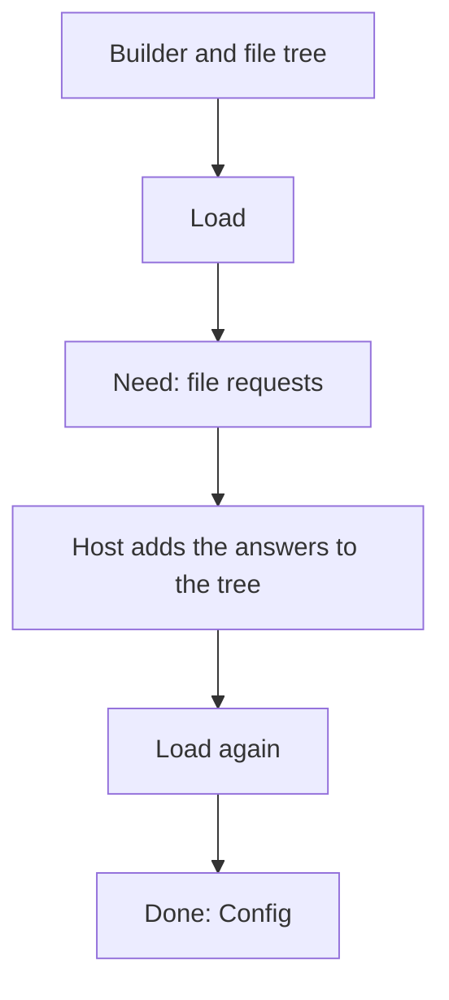

# Configuration

The `config` package (`@config`) loads configuration for a MoonBit application. It
reads ordered sources, parses files with the formats that you register, and merges
everything into one value tree. The package is pure: it never reads a file, the
process environment, or the working directory itself. A host gives it those inputs,
so a load gives the same result on `wasm`, `wasm-gc`, `js`, and `native`.

Import `moonrockz/moon-lander/config` as `@config` and a format package such as
`moonrockz/moon-lander/config/formats/toml` as `@toml`. Each `mbt check` block on
this page runs as a test with `mise run test`.

> [!NOTE]
> The configuration core is in progress. This page shows the API that exists
> today. Merge policies, secrets, and validation come in later changes. The
> [design overview](../../../docs/design/overview.md) shows the full plan.

## One load, start to finish

An application describes its sources with a builder. The pure `load` reads only
the builder and a file tree. When the tree does not hold a file that a source
needs, `load` asks for it. The host reads the files and calls `load` again.



| Step | What happens |
| --- | --- |
| Describe | Add sources and formats to a `ConfigBuilder`, in merge order |
| Load | `@config.load(builder, tree)` gives `Need(requests)` or `Done(config)` |
| Answer | The host adds each answer to the tree and loads again |
| Merge | Each source is parsed, filtered, and merged over the sources before it |
| Read | `Config::get`, `get_text`, `Config::reports`, and `Config::warnings` |

## The smallest program

Sources that hold values need no files. `build` loads them over an empty, complete
file tree. A later source wins.

```mbt check
///|
test "the smallest program" {
  let config = @config.build([
    @config.in_memory_pairs([("app.name", @config.string("demo"))]),
    @config.in_memory_pairs([("app.name", @config.string("acme"))]),
  ])
  @expect.expect(@config.get_text(config, "app.name")).to_equal("acme")
}
```

## Sources and the builder

Each source has a kind, a display name, a display priority, and an input. Add
them to the builder in merge order: low first, high last. Every function returns
a new builder, so you can keep a base builder and extend it.

| Constructor | Kind | Input |
| --- | --- | --- |
| `ConfigSource::defaults(json)`, `@config.defaults(builder, json)` | `Defaults` | A JSON object, for example `Defaults::default().to_json()` |
| `ConfigSource::defaults_value(value)` | `Defaults` | A value tree |
| `in_memory(value)`, `in_memory_pairs(pairs)` | `InMemory` | A value tree, or key-path and value pairs |
| `ConfigSource::file(path, role~)`, `@config.file(builder, path)` | `File(role)` | One explicit file |
| `ConfigSource::candidates(paths, display~)` | `File(role)` | A list of candidate files at one location |
| `ConfigSource::env(prefix~)`, `@config.env(builder, prefix~)` | `Environment` | Variables that start with `PREFIX_` |
| `ConfigSource::overrides(pairs)`, `@config.overrides(builder, pairs)` | `Overrides` | Key-path pairs, for example from the command line |
| `ConfigSource::skipped(kind)` | any | Nothing; the report shows `Skipped` |

```mbt check
///|
test "describe sources with a builder" {
  let base = @config.builder()
    |> @config.format(@toml.format())
    |> @config.defaults({ "server": { "port": 8080, "host": "localhost" } })
  let builder = base
    |> @config.file("/srv/app.toml")
    |> @config.add(
      @config.in_memory_pairs([("server.port", @config.int(9000))]),
    )
  let tree = @config.FileTree::new(complete=true).with_file(
    "/srv/app.toml",
    (
      #|[server]
      #|host = "example.org"
    ),
  )
  guard @config.load(builder, tree) is Done(config) else {
    fail("a complete tree never asks for files")
  }
  @expect.expect(@config.get_text(config, "server.host")).to_equal(
    "example.org",
  )
  @expect.expect(@config.get_text(config, "server.port")).to_equal("9000")
}
```

## The layer stack

Merge order decides which value wins. Each source also has a priority that reports
show. When you give no priority, it comes from the kind and the file role. An
in-memory source takes the priority of the source before it, so it fits at any
position.

```layers
Overrides (700) | command-line values
Environment variables (600) | APP_SERVER__PORT=9000
User override file (400) | app.user.toml
Local override file (390) | app.local.toml
Environment file (375) | app.Staging.toml
Workspace member file (350) | pkgs/api/app.toml
Workspace, explicit, or legacy file (300) | app.toml
Global user file (200) | ~/.config/app/
System file (100) | /etc/app/
Defaults (0) | compiled in
```

Added in this order, the sources merge from the bottom up, so the top layer wins.
A priority that is lower than the one before it is an error, because the list
order and the reports would disagree. Equal priorities are allowed.

```mbt check
///|
test "a decreasing priority is an error" {
  let builder = @config.builder()
    |> @config.add(@config.ConfigSource::skipped(Environment))
    |> @config.file("/srv/app.toml", priority=300)
  try @config.load(builder, @config.FileTree::new(complete=true)) catch {
    SourceOrder(previous~, previous_priority~, ..) =>
      @expect.expect((previous, previous_priority)).to_equal((
        "environment", 600,
      ))
    _ => fail("expected a source-order error")
  } noraise {
    _ => fail("expected a source-order error")
  }
}
```

## Files and the request loop

A `FileTree` is an immutable snapshot of what the host has read: directory
listings, file text, and absence records. A path is held, missing, or unknown.
`load` asks only for unknown paths, and it asks for all of them in one step. In a
complete tree every path that the tree does not hold is missing, so `load` never
asks.

| `FileTree` call | Effect |
| --- | --- |
| `FileTree::new(complete?)` | An empty tree |
| `with_file(path, text)` | Holds the text of a file |
| `with_listing(dir, entries)` | Holds a directory listing with the real names |
| `with_missing(path)` | Records a path as absent; a directory makes every path under it absent |

A host runs this loop. Native and js hosts read the disk; a wasm host gives a
complete tree. The loop below answers from a map, so it runs on every target.

```mbt check
///|
/// Answer one request from `disk`, a map from file path to text. A directory
/// exists when a file path in `disk` is below it.
fn answer(
  tree : @config.FileTree,
  request : @config.FileRequest,
  disk : Map[String, String],
) -> @config.FileTree {
  match request {
    ReadFile(path) =>
      match disk.get(path) {
        Some(text) => tree.with_file(path, text)
        None => tree.with_missing(path)
      }
    ListDir(dir) => {
      let entries : Array[@config.DirEntry] = []
      for path, _ in disk {
        guard path.has_prefix(dir + "/") else { continue }
        let rest = path[dir.length() + 1:].to_owned()
        let entry : @config.DirEntry = match rest.find("/") {
          Some(index) => { name: rest[:index].to_owned(), kind: Directory }
          None => { name: rest, kind: File }
        }
        if !entries.contains(entry) {
          entries.push(entry)
        }
      }
      if entries.is_empty() {
        tree.with_missing(dir)
      } else {
        tree.with_listing(dir, entries)
      }
    }
  }
}

///|
/// Load until the configuration is done, answering each request from `disk`.
fn load_from(
  builder : @config.ConfigBuilder,
  disk : Map[String, String],
  tree? : @config.FileTree = @config.FileTree::new(),
) -> @config.Config raise @config.ConfigError {
  match @config.load(builder, tree) {
    Done(config) => config
    Need(requests) =>
      load_from(
        builder,
        disk,
        tree=requests.fold(init=tree, (tree, request) => {
          answer(tree, request, disk)
        }),
      )
  }
}

///|
test "a host answers the requests of a load" {
  let builder = @config.builder()
    |> @config.working_dir("/srv")
    |> @config.format(@toml.format())
    |> @config.file("conf/app.toml")
  let config = load_from(builder, { "/srv/conf/app.toml": "name = \"acme\"" })
  @expect.expect(@config.get_text(config, "name")).to_equal("acme")
  @expect.expect(config.reports()[0].path).to_equal(Some("/srv/conf/app.toml"))
}
```

A relative path joins the working directory that `@config.working_dir` sets. A
missing explicit file is an error, `FileNotFound`.

## Candidate files

A candidate list names the files that may hold one source, for example
`app.toml` and `app.yaml` in one directory. A candidate exists when the listing of
its directory holds its exact name as a file, also on a file system that ignores
case. The load never chooses between two existing candidates.

| Existing candidates | Result |
| --- | --- |
| None | The report shows `NotFound` and the source adds nothing |
| One | The load reads and parses it; the report shows `Loaded` and its path |
| More than one | `Ambiguous(display~, location~, candidates~)` |

```mbt check
///|
test "one existing candidate loads" {
  let builder = @config.builder()
    |> @config.format(@toml.format())
    |> @config.add(
      @config.ConfigSource::candidates(
        ["/srv/app.toml", "/srv/.config/app.toml"],
        display="App",
      ),
    )
  let config = load_from(builder, { "/srv/.config/app.toml": "mode = \"dev\"" })
  let report = config.reports()[0]
  @expect.expect((report.status, report.path)).to_equal((
    Loaded,
    Some("/srv/.config/app.toml"),
  ))
}

///|
test "two existing candidates are ambiguous" {
  let builder = @config.builder()
    |> @config.format(@toml.format())
    |> @config.add(
      @config.ConfigSource::candidates(
        ["/srv/app.toml", "/srv/.config/app.toml"],
        display="App",
      ),
    )
  let disk = { "/srv/app.toml": "", "/srv/.config/app.toml": "" }
  try load_from(builder, disk) catch {
    Ambiguous(location~, candidates~, ..) as error => {
      @expect.expect(location).to_equal("/srv")
      @expect.expect(candidates.length()).to_equal(2)
      @expect.expect(error.message()).to_start_with(
        "Ambiguous App configuration; found:",
      )
    }
    _ => fail("expected an ambiguity error")
  } noraise {
    _ => fail("expected an ambiguity error")
  }
}
```

## Formats

A format turns file text into a value tree with a struct root. Register the
formats that the application reads; the file extension selects one, compared in
lowercase. `parse_file` gives other packages the same selection.

| Package | Format | Extensions | Status |
| --- | --- | --- | --- |
| `config/formats/toml` | TOML | `toml` | Exact integers, dates and times |
| `config/formats/yaml` | YAML | `yaml`, `yml` | Default and strict profiles |
| `config/formats/json5` | JSON and JSON5 | `json`, `json5` | Comments allowed; see package README for precision limits |
| `config/formats/ion` | Ion | `ion` | Text only; one top-level struct |

```mbt check
///|
test "the extension selects the format" {
  let formats = @config.builder()
    |> @config.format(@toml.format())
    |> @config.ConfigBuilder::formats
  @expect.expect(@config.parse_file(formats, "/srv/APP.TOML", "a = 1")).to_equal(
    @config.fields([("a", @config.int(1))]),
  )
  try @config.parse_file(formats, "/srv/app.ion", "{}") catch {
    UnsupportedFormat(extensions~, ..) =>
      @expect.expect(extensions).to_equal(["toml"])
    _ => fail("expected an unsupported-format error")
  } noraise {
    _ => fail("expected an unsupported-format error")
  }
}
```

The [`formats`](../formats/README.md) virtual package supplies all four format
packages by default. A main-package override selects TOML only or an
application-defined set without changing the application source.

## Merge rules

| Base | Overlay | Result |
| --- | --- | --- |
| any | null | The base value stays, at any depth |
| struct | struct | Fields merge one by one; base fields first, new fields after |
| any | any other value | The overlay wins |
| list | list | The overlay list replaces the base list |

A merged configuration never holds a null struct field: a null with no base value
adds nothing. Nulls inside lists stay. The merge never changes its inputs.

## Where each value came from

Every leaf of the merged tree has a non-empty list of origins: the kind, the
display name, the priority, and the file path of the source that set it. A list
counts as one leaf. A struct has no origin of its own, and a value that replaces a
struct removes the records below it. Reports name each kind as Morphir does, for
example `project` for a workspace file and `user-override` for a user override.

```mbt check
///|
test "the origin of each value" {
  let config = @config.build([
    @config.ConfigSource::defaults({ "ir": { "layout": "tree", "mode": "safe" } }),
    @config.in_memory_pairs(
      [("ir.mode", @config.string("fast"))],
      name="command line",
    ),
  ])
  let origins = config.provenance().map(record => {
    (record.0.to_string(), record.1.map(origin => origin.source))
  })
  @expect.expect(origins).to_equal([
    ("ir.layout", ["defaults"]),
    ("ir.mode", ["command line"]),
  ])
  @expect.expect(config.reports()[0].kind.report_name()).to_equal("defaults")
}
```

## Excluding a subtree

A source can drop key paths after the parse and before the merge. A layer that a
project inherits can drop the identity of another project without a warning. A
member layer can drop a key that only the workspace may set, with a warning.

```mbt check
///|
test "an excluded key warns" {
  let source = @config.in_memory_pairs([
      ("workspace.out_dir", @config.string("out")),
      ("ir.layout", @config.string("tree")),
    ])
    .exclude([@config.KeyPath::parse("workspace.out_dir")], warn=true)
  let config = @config.build([source])
  @expect.expect(config.get(@config.KeyPath::parse("workspace.out_dir"))).to_equal(
    None,
  )
  @expect.expect(config.warnings().length()).to_equal(1)
}
```

## Source providers

A source provider gives sources during the load, at its position in the list.
Discovery uses this hook. A provider gets a `LoadContext` with the file tree, the
platform, the variable set, the working directory, and the formats. It gives
`Need(requests)` until the tree holds what it reads, then `Done` with its sources
and warnings. A provider reads only the context, never the process.

```mbt check
///|
test "a provider adds the file of its directory" {
  let local_file : @config.SourceProvider = {
    name: "local",
    expand: context => {
      guard context.working_dir is Some(dir) else {
        return Done({ sources: [], warnings: [] })
      }
      Done({
        sources: [
          @config.ConfigSource::candidates(
            ["\{dir}/app.local.toml"],
            display="local",
            role=LocalOverride,
          ),
        ],
        warnings: [],
      })
    },
  }
  let builder = @config.builder()
    |> @config.working_dir("/srv")
    |> @config.format(@toml.format())
    |> @config.provider(local_file)
  let config = load_from(builder, { "/srv/app.local.toml": "debug = true" })
  @expect.expect(@config.get_text(config, "debug")).to_equal("true")
  @expect.expect(config.reports()[0].priority).to_equal(390)
}
```

## Bind typed values

Read a section into a typed value with `bind`, or the full configuration with
`bind_root`. Any type that implements `FromJson` works, usually through
`derive(FromJson)`. A section that no source sets decodes as `null`, so an
`Option` target gives `None`.

```mbt check
///|
struct ServerOptions {
  host : String
  port : Int
} derive(FromJson, Eq, Debug)

///|
test "bind a section to a record" {
  let config = @config.build([
    @config.ConfigSource::defaults({
      "server": { "host": "localhost", "port": 8080 },
    }),
  ])
  let server : ServerOptions = config |> @config.bind("server")
  @expect.expect(server).to_equal({ host: "localhost", port: 8080 })
  let metrics : ServerOptions? = config.bind("metrics")
  @expect.expect(metrics).to_equal(None)
}
```

A decode failure raises `Decode`. Its text names the decode path, the decoder
detail, and the sources that set the bad value, as
`<path>: <detail> (<blame text>)`. A path inside a list shows the index, for
example `targets[1].level`. The text never shows the configured value.

| Blame | Text | When |
| --- | --- | --- |
| `Set(origins)` | `set in project /repo/app.toml` | A source set the leaf or the list |
| `Table(origins)` | `table set in ...` | The key is a table, for example a missing field |
| `Unset` | `not set by any source` | No source sets the key |

```mbt check
///|
test "a decode error names the file that set the value" {
  let builder = @config.builder()
    |> @config.format(@toml.format())
    |> @config.file("/srv/app.toml")
  let tree = @config.FileTree::new(complete=true).with_file(
    "/srv/app.toml",
    "server.host = \"example.org\"\nserver.port = \"eighty\"",
  )
  guard @config.load(builder, tree) is Done(config) else { fail("no config") }
  try {
    let _ : ServerOptions = config |> @config.bind("server")
  } catch {
    error =>
      @expect.expect(error.message()).to_equal(
        "server.port: Int::from_json: expected number (set in project /srv/app.toml)",
      )
  } noraise {
    _ => fail("expected a decode error")
  }
}
```

## Bind over a default value

`bind_or` merges the configured section over a typed default, with the same rules
as the configuration merge: tables merge, a configured list or scalar replaces
the default, and an absent section keeps the default. The type needs `ToJson` as
well as `FromJson`. A failure in a value that the default gave says
`from the bind default`.

```mbt check
///|
struct ServerDefaults {
  host : String
  port : Int
  tags : Array[String]
} derive(FromJson, ToJson, Eq, Debug)

///|
test "configured keys win over the default" {
  let config = @config.build([
    @config.in_memory_pairs([
      ("server.port", @config.int(9000)),
      ("server.tags", @config.list([@config.string("eu")])),
    ]),
  ])
  let server = config
    |> @config.bind_or("server", ({
      host: "localhost",
      port: 8080,
      tags: ["default"],
    } : ServerDefaults))
  @expect.expect(server).to_equal({ host: "localhost", port: 9000, tags: ["eu"] })
  @expect.expect(config.bind_or("mode", "safe")).to_equal("safe")
}
```

Binding decodes through `FromJson`, so its rules apply:

| Case | Result |
| --- | --- |
| `Int` from `1.5` | `1`: the fraction is lost without an error |
| `Int64` from a number | An error: `Int64` decodes only from text such as `"42"` |
| An `Option` field that is absent | `None` |
| An unknown field | Ignored |

The configuration never holds a null field, so a `null` in a source does not
reach an `Option` field: the field is absent and decodes as `None`.

## Environment variables and overrides

An environment source reads the variables that start with its prefix. `__`
separates names, and the names are written in lower case, so
`ACME_SERVER__PORT=9000` sets `server.port`. Values get a type: `true` and
`false`, integers, and JSON lists or tables; other text stays a string. The
origin of each value names its variable. An overrides source, for example from
the command line, has the highest default priority, 700.

```mbt check
///|
test "an environment variable overrides a file" {
  let builder = @config.builder()
    |> @config.env_vars({ "ACME_SERVER__PORT": "9000", "HOME": "/home/u" })
    |> @config.format(@toml.format())
    |> @config.file("/srv/acme.toml")
    |> @config.env(prefix="ACME")
  let tree = @config.FileTree::new(complete=true).with_file(
    "/srv/acme.toml",
    "server.port = 8080\nserver.host = \"example.org\"",
  )
  guard @config.load(builder, tree) is Done(config) else { fail("no config") }
  @expect.expect(@config.get_text(config, "server.port")).to_equal("9000")
  let origin = config.origins(@config.KeyPath::parse("server.port"))[0]
  @expect.expect(origin.location).to_equal(Some("ACME_SERVER__PORT"))
}
```

| Rule | Example |
| --- | --- |
| The prefix matches in any case | `acme_ui__color=false` sets `ui.color` |
| `_` after the prefix is skipped; a single `_` stays in a name | `ACME__IR_FORMAT=3` sets `ir_format` |
| An empty name is an error | `ACME_A____B` raises `InvalidEnvKey` |
| Reserved names stay out | `reserved=["ACME_HOME"]` |
| A shorter path merges last | `ACME_IR=x` replaces `ACME_IR__MODE=fast` |
| `Discover` with no variable set | The report shows `NotFound` |

## Hosts

The core never reads the disk or the process. A host gives it those inputs.

| Target | How to load |
| --- | --- |
| `native`, `js` | `@host.load(builder)` from [`config/host`](host/README.mbt.md) reads the files, and the process variables and working directory when the builder holds none. The js adapter runs on Node and Bun |
| `wasm`, `wasm-gc` | The host gives a complete `FileTree`, a variable set, and a working directory, then calls `@config.load` once |

```mbt check
///|
test "a wasm host gives every input" {
  let builder = @config.builder()
    |> @config.env_vars({ "ACME_MODE": "fast" })
    |> @config.working_dir("/app")
    |> @config.format(@toml.format())
    |> @config.file("acme.toml")
  let tree = @config.FileTree::new(complete=true).with_file(
    "/app/acme.toml",
    "mode = \"safe\"",
  )
  guard @config.load(builder, tree) is Done(config) else {
    fail("a complete tree never asks for files")
  }
  @expect.expect(@config.get_text(config, "mode")).to_equal("safe")
}
```

## Errors

Every failure is one `ConfigError` case with labelled fields, so a caller matches
the case and does not compare text. `message()` gives text for people.

| Case | When |
| --- | --- |
| `Parse`, `InvalidRoot`, `DuplicateKey` | A file or value tree is not valid |
| `FileNotFound` | An explicit file does not exist |
| `UnsupportedFormat` | No registered format reads the extension |
| `Ambiguous` | More than one candidate exists |
| `SourceOrder` | A priority decreases |
| `InvalidKeyPath`, `KeyNotFound`, `Render` | A key path or a lookup fails |

Later changes raise the other cases: environment keys, merge keys, secrets,
discovery, and binding.
